# Reclipse

**Uma IDE Java nativa em Rust.** O objetivo é ser a IDE Java mais rápida de todos os tempos: cold start baixo, memória previsível, indexação paralela e uma UI que não depende de SWT nem de um GC.

Este repositório contém o **MVP 0.1.0**, o **M1** do editor e a **fundação do M2** (classpath + semântica Java), funcionais e executáveis, além do plano técnico para chegar a uma IDE completa e a uma camada de compatibilidade com o ecossistema Eclipse.

> Projeto independente. Não é afiliado à Eclipse Foundation. Eclipse e JDT são marcas dos seus respectivos titulares.

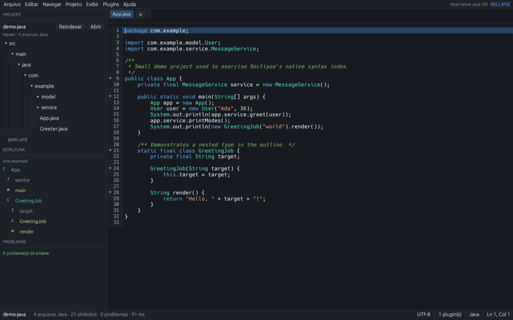

---

## O que já funciona

- Shell nativo em Rust com **egui/eframe** (GPU), tema escuro e layout de IDE.
- **RECLIPSE Studio**: identidade visual com emblema desenhado em GPU, fontes embutidas (Cal Sans/Commissioner/Source Code Pro), activity bar, toolbar de ações, breadcrumb, right dock de outline/telemetria, console de diagnóstico e **3 temas** comutáveis (`Exibir → Tema`): Rust Oxide, Eclipse Dark Cósmico e Cyber Solar Eclipse. Persistidos na sessão.
- Abertura de pasta/projeto com descoberta de fontes Java:
  - Eclipse (`.project` + `.classpath`)
  - Maven (`pom.xml`, `src/main/java`, `src/test/java`)
  - Gradle (layout convencional)
  - projeto Java simples (fallback)
- Editor de código com:
  - buffer **rope** e renderização **virtualizada** (só linhas visíveis)
  - destaque de sintaxe Java incremental por linha
  - números de linha, linha atual, seleção, cursor piscante
  - **multi-cursor** (`Ctrl+Alt+↓/↑`, Alt+clique) e **seleção por coluna** (Alt+arrastar), com undo agrupado por rajada de digitação
  - **folding** por bloco, com marcador na gutter, atalhos e persistência na sessão
  - undo/redo agrupado, copiar/cortar/colar, autoindent
  - abas, indicador de alteração, salvar (`Ctrl+S`)
  - posição do cursor na barra de status
- **Busca e substituição** no arquivo (`Ctrl+F`/`Ctrl+H`) com regex (incluindo grupos `$1`), palavra inteira, destaques e navegação.
- **Busca no projeto** (`Ctrl+Shift+F`) em thread separada, com resultados clicáveis e substituição no projeto.
- **Classpath nativo** Eclipse/Maven/Gradle + JDK, com dependências transitivas, BOM/platform, version catalogs e watch de `pom.xml`/`.classpath`/`build.gradle`; o JDK é escolhido pelo target do projeto.
- **Open Type** inclui tipos do projeto e do classpath; **F3** em tipo externo abre o visualizador de metadados e, quando há `-sources.jar`/`src.zip`, o código-fonte.
- **Completion inline** de membros (`Ctrl+Space` ou após `.`), com herança de classes/interface do projeto **e** do classpath, filtro incremental, aceite por Enter/Tab e **tipos de retorno encadeados** (`service.find().`).
- **Hover semântico** de tipos, variáveis e símbolos.
- **Referências** no projeto (`Ctrl+Shift+G`): semânticas para tipos, métodos, campos e constantes (incluindo herança e method references), referências locais no buffer e fallback textual.
- **Rename conservador** (`Alt+Shift+R`) de tipos, métodos, campos e variáveis locais/parâmetros:
  - atualiza declaração, referências e imports;
  - renomeia o `.java` de tipos top-level e atualiza o índice sem recarregar o classpath;
  - recusa classpath/JDK, colisões, sombreamento de locais e métodos sobrescritos/implementados;
  - aplica edits em lote e um único passo de undo para rename local.
- **Compilação e execução**: **Compilar** com `javac` (classpath do projeto + `--release` do target), **Build compile/package/clean** do Maven/Gradle com saída incremental, diagnósticos no painel Problemas e **Executar** a classe `main` com `java` (`Ctrl+F11`). Debug JDWP/JDI fica para o M4.
- **JUnit inline**: descoberta de testes JUnit 4/5, árvore classe → método no right dock, execução por classe ou método e falhas clicáveis com stack frame.
- **Editor dividido** com dois painéis e **abas arrastáveis** (drag-and-drop) entre eles.
- **Organizar imports** (`Ctrl+Shift+I`) e **formatar arquivo** via formatter externo opt-in (`Ctrl+Alt+F`).
- **Console ANSI**: cores SGR, histórico persistido e limites explícitos (600 linhas, 4 KiB/linha).
- **Rename de pacote** (com subpacotes): atualiza `package`, imports, referências qualificadas e move os `.java` entre source roots.
- **Inferência de `var`** em inicializadores simples (`new Type(...)`, literais) para completion/hover.
- Diagnóstico de **imports não resolvidos** no painel de problemas.
- **File watcher**: recarga automática de arquivos limpos alterados no disco e banner de conflito para buffers sujos.
- **Recuperação de buffers sujos** após fechar/crash, com diálogo de recuperação.
- **Sessão persistente**: projeto, abas, cursor, folds, painéis, fonte e keybindings.
- **Keybindings no padrão Eclipse** (Open Resource, Open Type, Quick Access, Quick Outline, F3), configuráveis via `session.json`.
- Indexação paralela de arquivos Java com **tree-sitter-java + Rayon**:
  - pacote, imports, classes, interfaces, enums, records, anotações
  - métodos, construtores, campos, constantes de enum
  - erros de sintaxe
- Painéis de **Projeto**, **Estrutura (outline)** e **Problemas**.
- **Open Resource** (`Ctrl+Shift+R`) com busca fuzzy.
- **Quick Access** (`Ctrl+3`).
- **Ir para definição** (`F3`) com prioridade semântica (local → tipo → membro do projeto/classpath) e fallback sintático quando há um único candidato.
- **Plugins nativos em Rust** com ABI C versionada (`v1`) e comandos JSON.
- Plugin de exemplo (`hello-plugin`) que insere texto e mostra estatísticas do arquivo.

Busca no arquivo com destaque de todas as ocorrências:

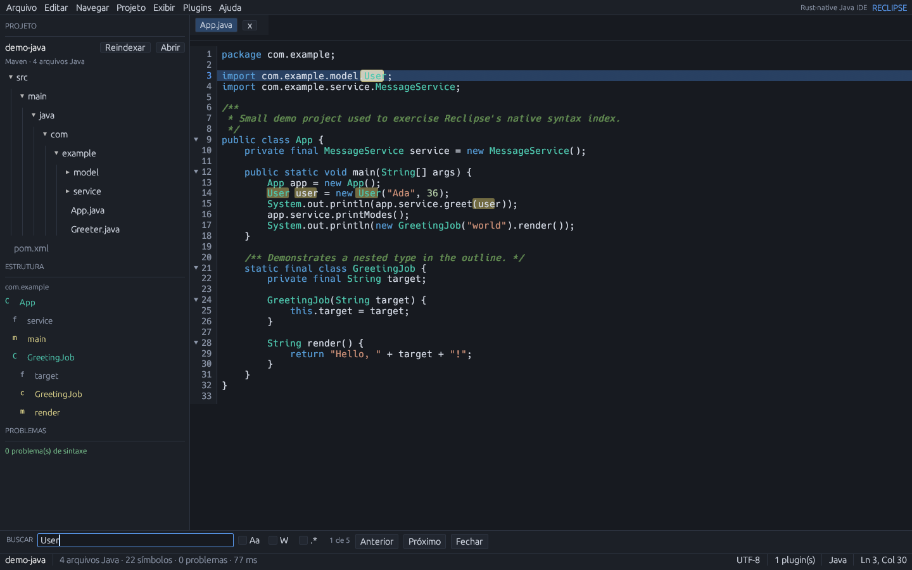

Conflito entre buffer sujo e alteração externa:

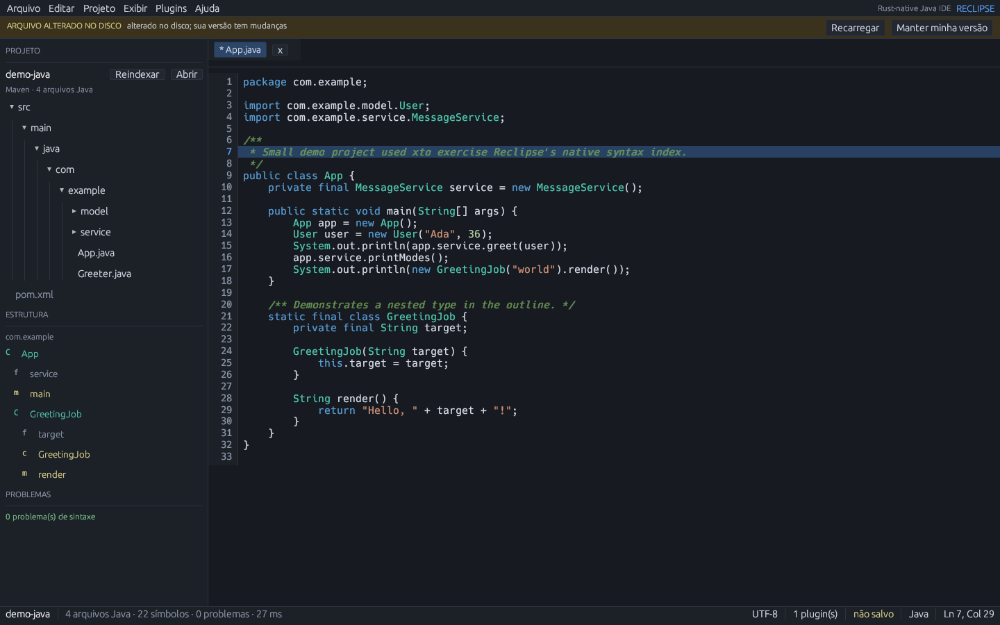

Código dobrado por bloco:

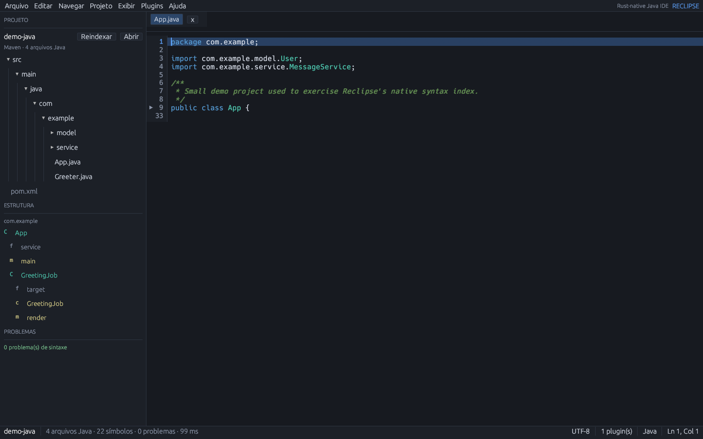

Recuperação de buffers após uma sessão anterior:

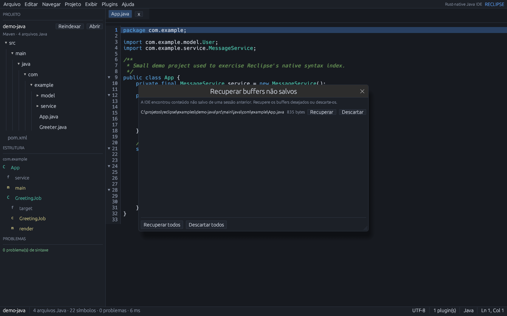

100 abas abertas com sessão restaurada:

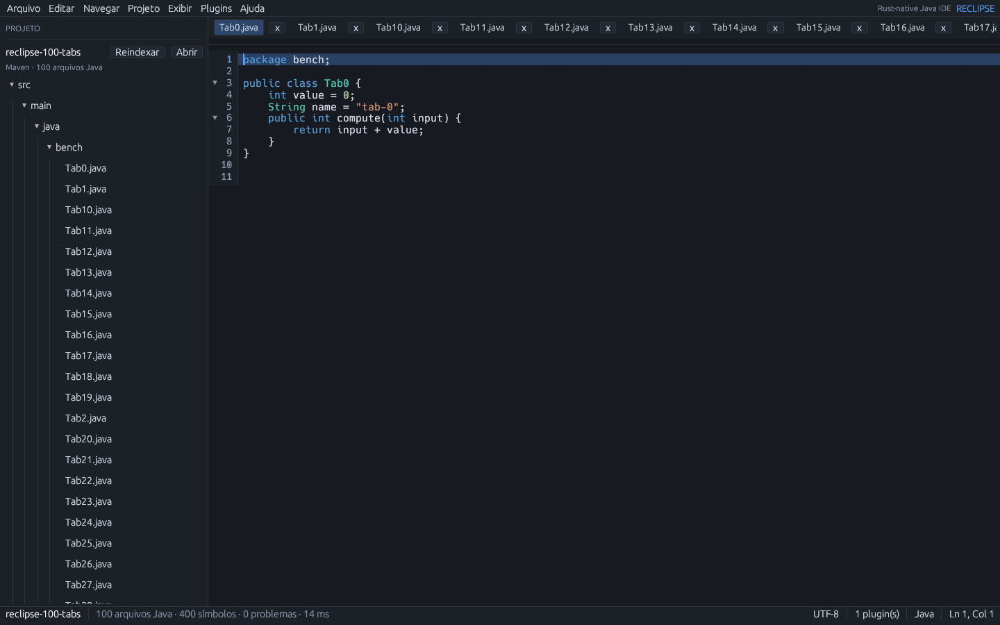

## Temas (RECLIPSE Studio)

O motor de tema troca paleta, cores de sintaxe, seleção, linha atual, emblema e barra de status em tempo real. O design system completo está em [docs/DESIGN_SYSTEM.md](docs/DESIGN_SYSTEM.md).

Rust Oxide Industrial (padrão):

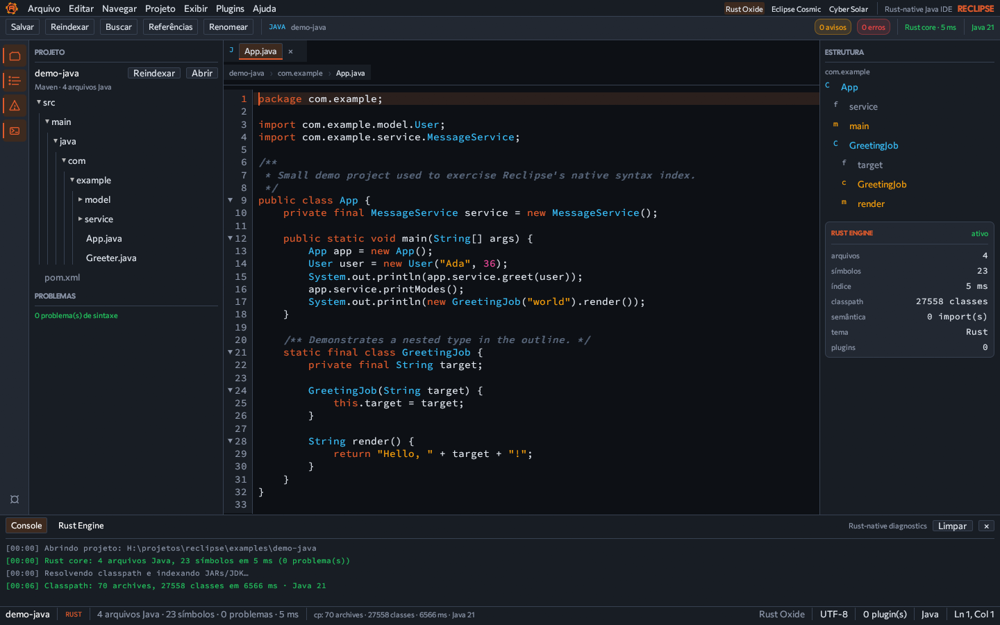

Eclipse Dark Cósmico:

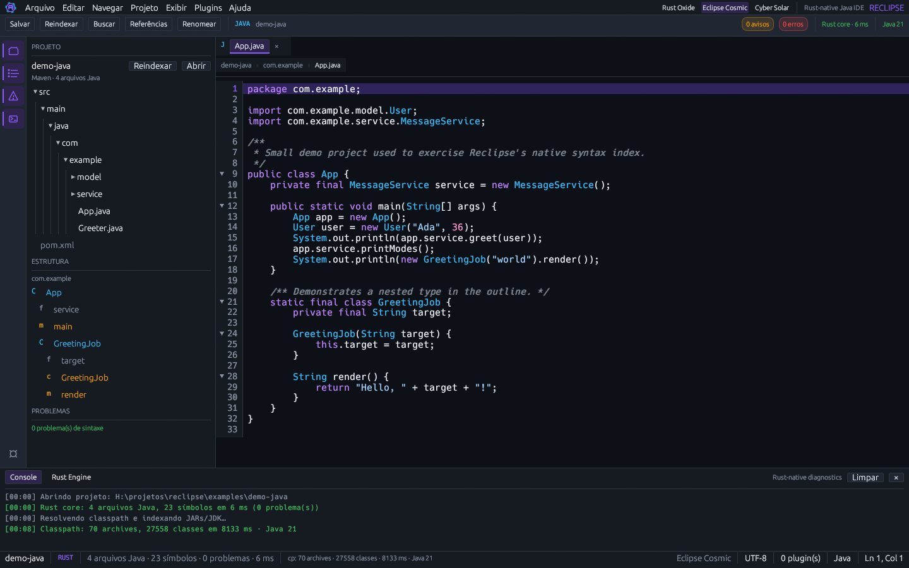

Cyber Solar Eclipse:

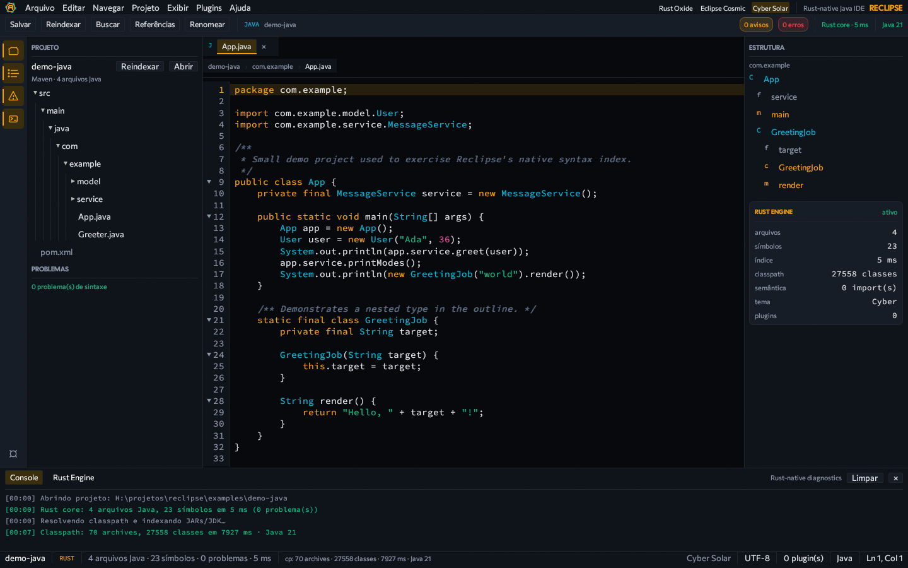

## Build, execução e editor dividido

Compilação real com `javac`, diagnósticos no painel de problemas e execução da `main` no console:

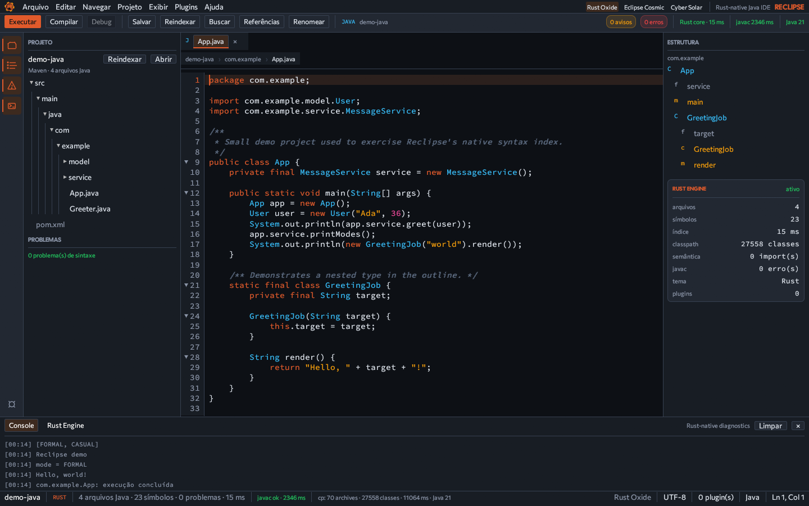

Dois editores lado a lado com abas arrastáveis:

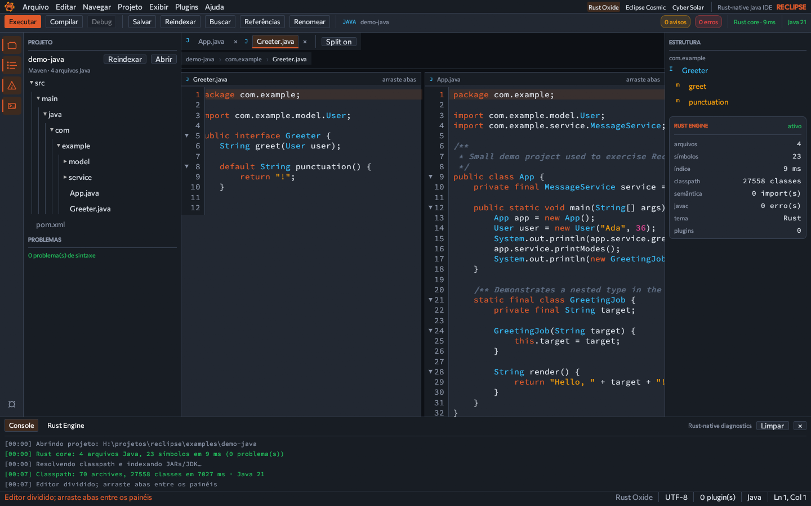

Descoberta de testes JUnit no right dock:

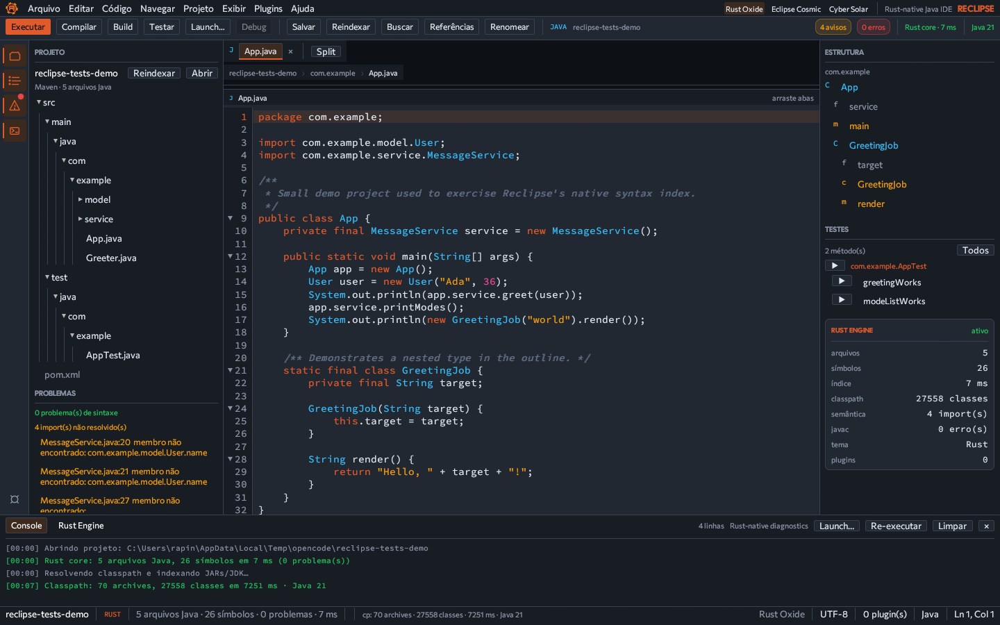

## O que ainda não existe

Este MVP é deliberadamente honesto sobre o escopo:

- Compila e executa `main` via `javac`/`java` com launch config, roda `mvn test`/`gradle test` com parser e JUnit inline por classe/método, mas ainda não depura (JDWP/JDI) e não executa ciclos de build Maven/Gradle completos.
- O formatter é externo e opt-in (`RECLIPSE_FORMATTER`/`RECLIPSE_FORMATTER_JAR`); organize imports é nativo e conservador.
- A semântica Java cobre imports/tipos, completion de membros, hover, referências semânticas de tipos/membros, rename conservador, overloads por tipo, type variables com substituição e diagnósticos nativos (tipos/membros não resolvidos, `@Override`, static ambíguo) além do `javac` em fundo; faltam apenas refinamentos (overloads finos por subtipo, Javadoc, modo JDT opt-in). Tipos locais são detectados; tipos anônimos ainda não são modelados.
- Rename não reescreve Javadoc, strings, configuração por reflexão ou nomes em arquivos de recursos; overrides/implementações e locais sombreados são recusados por segurança, e o rename de workspace exige buffers Java salvos.
- Maven/Gradle resolvem dependências transitivas do repositório local e têm download sob demanda e perfis Maven; não há Tooling API nem bundles avançados do Gradle.
- Multi-cursor agrupa undo de digitação, mas backspace/delete multi ainda são por tecla.
- Não é um substituto completo do Eclipse para projetos corporativos.
- Plugins Eclipse/OSGi/SWT **não** são carregados ainda. A compatibilidade headless está no roadmap.
- Há **JDT LS opt-in** via `RECLIPSE_JDTLS` (diagnósticos extras), desabilitado por padrão; não é um LSP embutido completo.

Veja [docs/M1.md](docs/M1.md) para o detalhamento do editor, [docs/M2.md](docs/M2.md) para o classpath/semântica e [docs/ROADMAP.md](docs/ROADMAP.md) para os próximos marcos.

---

## Rodar

Pré-requisitos:

- Windows 10/11 (o alvo atual; o código é portável para Linux/macOS)
- Rust estável com toolchain MSVC
- Visual Studio Build Tools com “Desktop development with C++” (tree-sitter compila C)
- Nenhum JDK é obrigatório; se um for encontrado, o classpath do JDK é indexado automaticamente.

```powershell
cargo run -p reclipse-ui -- examples/demo-java
```

Build release:

```powershell
cargo build --release -p reclipse-ui
.\target\release\reclipse.exe examples\demo-java
```

Também é possível abrir a IDE sem argumentos e escolher **Arquivo → Abrir pasta…**.

## Atalhos (padrão Eclipse)

| Atalho | Ação |
|---|---|
| `Ctrl+Shift+R` | Open Resource (quick open de arquivos) |
| `Ctrl+Shift+T` | Open Type (tipos do índice) |
| `Ctrl+3` | Quick Access (command palette) |
| `Ctrl+O` | Quick Outline do arquivo ativo |
| `Ctrl+F` | Localizar no arquivo |
| `Ctrl+H` | Substituir no arquivo |
| `Ctrl+Shift+F` | Buscar no projeto |
| `Ctrl+K` / `Ctrl+Shift+K` | Próxima / anterior ocorrência |
| `Ctrl+Space` | Completion de tipos/membros |
| `Ctrl+Shift+G` | Referências (semânticas para tipos/membros; locais no buffer) |
| `Alt+Shift+R` | Renomear tipo/método/campo/variável local |
| `Ctrl+F11` | Compilar e executar a classe `main` |
| `Ctrl+Shift+I` | Organizar imports |
| `Ctrl+Alt+F` | Formatar arquivo (formatter externo) |
| `F11` | Debug (planejado para o M4) |
| `Ctrl+Shift+L` | Ajuda de atalhos |
| `F3` | Ir para definição |
| `F5` | Reindexar |
| `Ctrl+S` | Salvar |
| `Ctrl+W` | Fechar aba |
| `Ctrl+Alt+O` | Abrir arquivo |
| `Ctrl+Shift+O` | Abrir pasta/projeto |
| `Ctrl+Alt+↓/↑` | Adicionar cursor abaixo/acima |
| `Alt+clique` / `Alt+arrastar` | Adicionar cursor / seleção por coluna |
| `Ctrl+Z` / `Ctrl+Y` | Desfazer / refazer no editor |
| `Esc` | Fechar palette/busca ou reduzir cursores |

Os atalhos de arquivo, navegação, busca e projeto podem ser redefinidos em `%APPDATA%\Reclipse\session.json` (ou `~/.config/reclipse/session.json`). Atalhos de edição de texto e refactor (rename) permanecem fixos nesta versão.

## Sessão e configuração

A IDE salva projeto, abas, cursor, visibilidade dos painéis (incluindo o console), tema, tamanho da fonte e keybindings ao sair. Abra **Ajuda → Abrir configuração (session.json)** para editar. Alterações de keybinding exigem reinício; edições externas de keybindings são preservadas ao fechar a IDE.

O campo `theme` aceita `rust-oxide` (padrão), `eclipse-cosmic` ou `cyber-solar`. Também é possível iniciar com `RECLIPSE_THEME=cyber-solar`.

O formatter é externo e opt-in: defina `RECLIPSE_FORMATTER` (executável que lê o código pela stdin) ou `RECLIPSE_FORMATTER_JAR` (jar do google-java-format). `Ctrl+Shift+I` organiza imports nativamente.

Buffers sujos são gravados em backups para recuperação; a sessão guarda abas, cursor, folds, painéis e keybindings.

## Plugins Rust

O plugin de exemplo já é carregado automaticamente quando compilado:

```powershell
cargo build -p reclipse-plugin-hello
cargo run -p reclipse-ui -- examples/demo-java
```

O host procura por `reclipse_plugin_*.dll` (ou `.so`/`.dylib`) no diretório do executável, em `./plugins` e em `RECLIPSE_PLUGIN_PATH`. Abra `Ctrl+3` (Quick Access) e procure por:

- `Hello: inserir timestamp`
- `Hello: estatísticas do arquivo ativo`

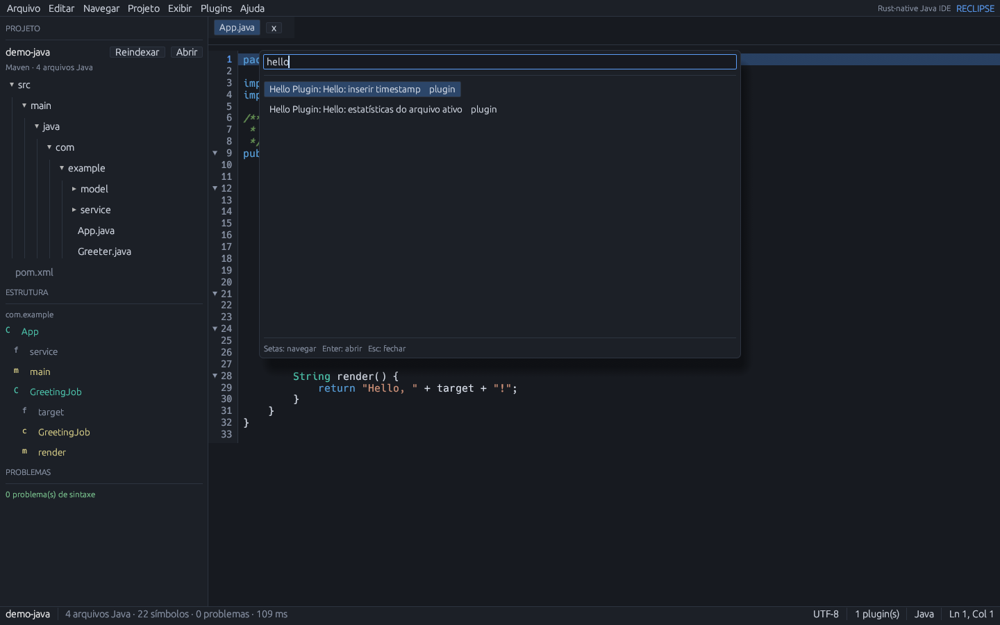

Detalhes do ABI, ownership de strings, ciclo de vida e versionamento: [docs/PLUGIN_SDK.md](docs/PLUGIN_SDK.md).

## Estrutura do repositório

```text
crates/
  reclipse-core/        descoberta de projetos e modelo de workspace
  reclipse-classpath/   classpath Eclipse/Maven/Gradle + índice de JARs/JMODs
  reclipse-java/        parser tree-sitter, índice de símbolos, semântica e refactors
  reclipse-editor/      documento, cursor, lexer de destaque
  reclipse-plugin-api/  ABI C v1 e protocolo JSON
  reclipse-plugin-host/ carregamento e despacho de plugins
  reclipse-ui/          aplicativo egui/eframe (binário `reclipse`)
plugins/
  hello-plugin/         plugin nativo de exemplo (cdylib)
examples/
  demo-java/            projeto Java para experimentar
docs/
  ARCHITECTURE.md       arquitetura e metas de performance
  M1.md                 editor rope, busca, watcher, sessão e keybindings
  M2.md                 classpath nativo, índice de classes e semântica inicial
  M3.md                 compilação javac, execução de main e split editor
  ROADMAP.md            marcos, estimativas e critérios
  PLUGIN_SDK.md         guia do ABI de plugins
  ECLIPSE_COMPAT.md     estratégia realista para plugins Eclipse
  DESIGN_SYSTEM.md      identidade visual, temas, tipografia e componentes
```

## M1 — Editor de produção

O marco M1 substituiu o `TextEdit` por um editor próprio com rope, virtualização de linhas e lexer incremental. Também adicionou busca/substituição (literal, regex e palavra inteira), busca/substituição no projeto, watcher com conflitos, sessão persistente, keybindings no padrão Eclipse, folding, multi-cursor, seleção por coluna e recuperação de buffers sujos.

Detalhes técnicos, métricas e limitações: [docs/M1.md](docs/M1.md).

## M2 — Motor Java (completion, referências e rename entregues)

O M2 cobre classpath Eclipse/Maven/Gradle/JDK com dependências transitivas, escolha de JDK pelo target, índice nativo de classes de JARs/JMODs, Open Type com tipos externos, F3 abrindo metadados do classpath e diagnóstico de imports não resolvidos.

A camada semântica adiciona inferência de variáveis (inclusive generics, arrays e `var`), completion de membros inline com herança de tipos do projeto e do classpath, tipos de retorno encadeados com type arguments, hover de tipos/variáveis, referências semânticas de tipos/métodos/campos (com precedência de static imports) e rename conservador com atualização de imports e arquivo. Plano e limitações: [docs/M2.md](docs/M2.md).

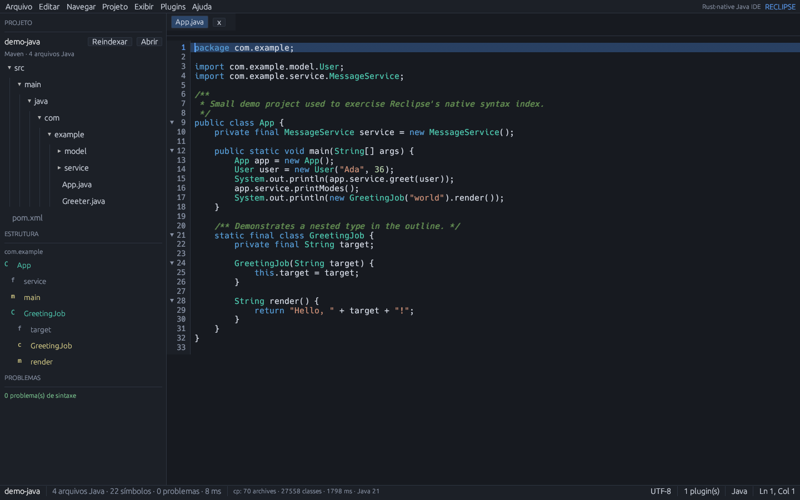

Completion de membros de `MessageService` após `app.service.`:

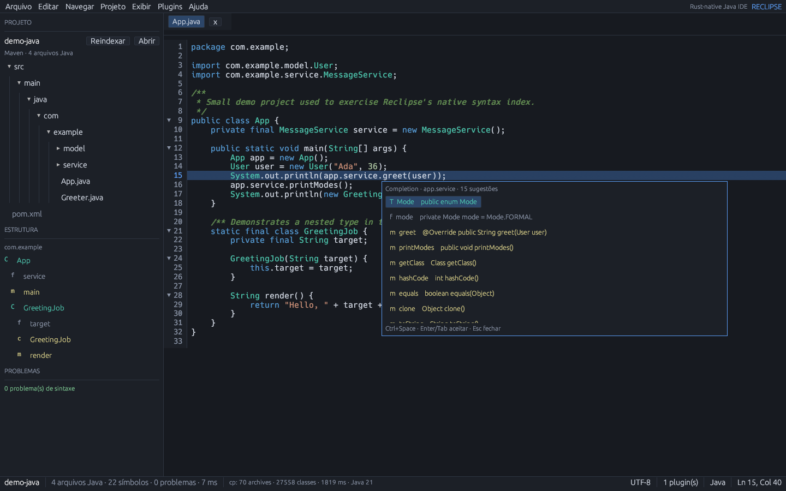

Hover semântico de um tipo do projeto:

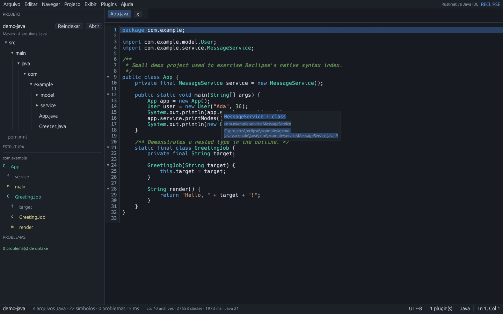

Referências semânticas de `MessageService`:

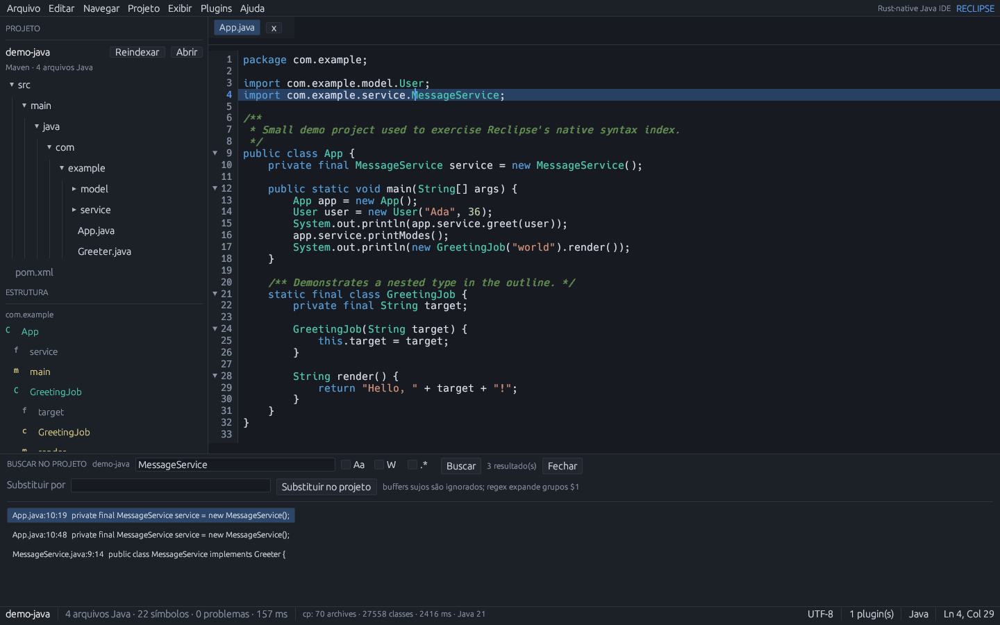

Rename de `MessageService` com prévia de ocorrências e rename do arquivo:

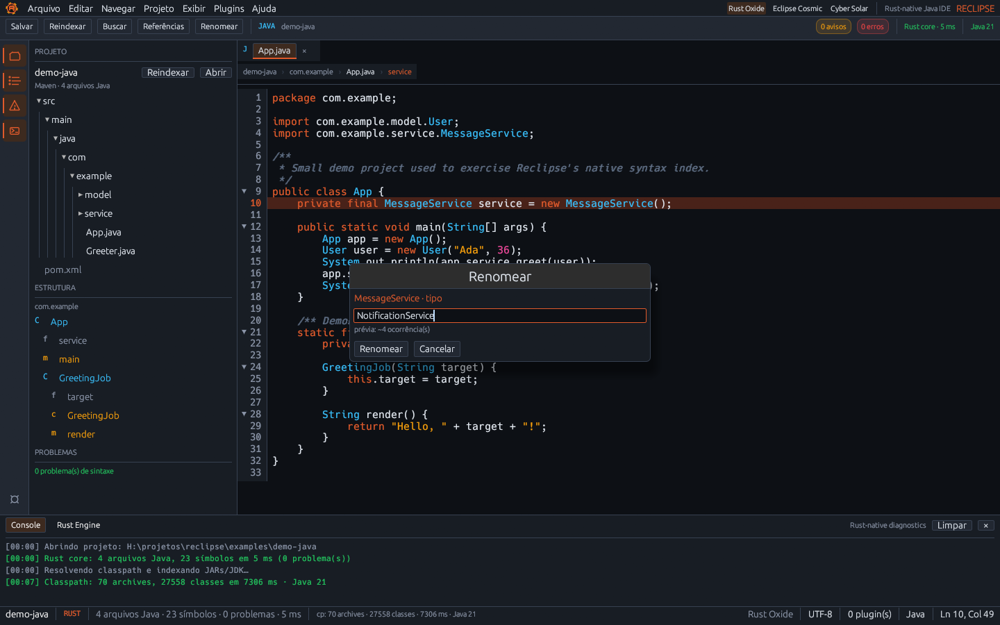

Código-fonte de `java.lang.String` lido do `src.zip` do JDK:

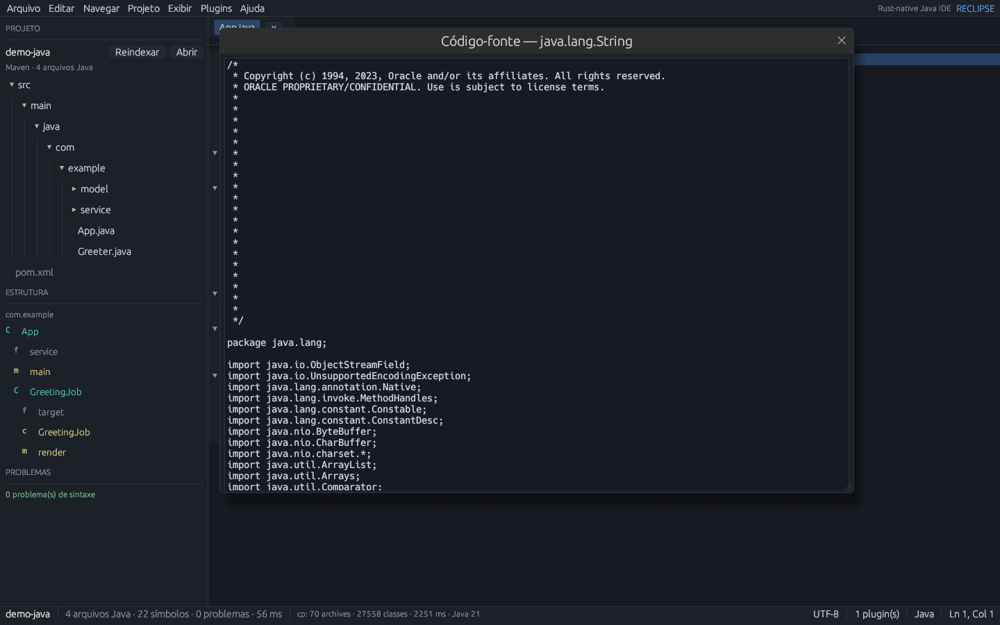

Open Type com a query `java.lang.String` e tipos do classpath:

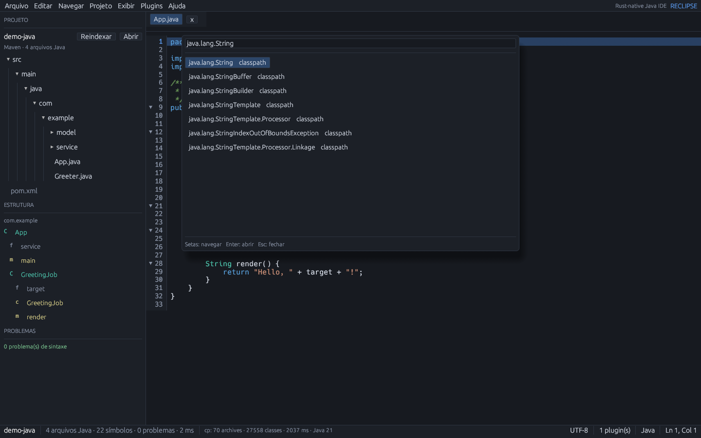

Visualizador de metadados de um tipo externo:

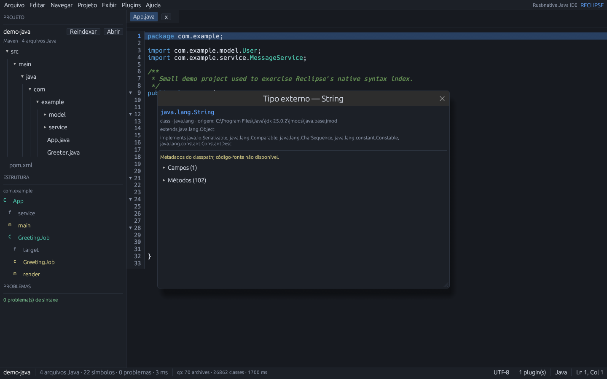

## Performance

Metas de engenharia (a medir em cada release, não promessas do MVP):

| Métrica | Meta |
|---|---|
| Cold start (até primeira janela) | < 150 ms |
| Abrir projeto de 1M LOC | < 2 s para o índice sintático |
| Latência de tecla | < 16 ms (p95) |
| Reindexação incremental | < 50 ms por arquivo |
| Memória em repouso (projeto médio) | < 300 MB |
| Memória em projeto grande | < 800 MB |

O editor do M1 usa rope + widget virtualizado próprio, então apenas as linhas visíveis são layoutadas. O frame benchmark mede o `update` completo do egui; ainda faltam “select next occurrence” e column mode por teclado.

Medição local de referência (Windows 10, i5-4590, 4 núcleos, build release):

| Cenário | Resultado |
|---|---|
| Abrir arquivo de 100k linhas | 12 ms |
| Lexer completo das 100k linhas | 152 ms |
| 1.000 edições no arquivo de 100k linhas | 1 ms |
| Abrir 100 abas (1k linhas cada, 3,58 MB) | 18 ms |
| Indexar 2.000 arquivos Java / 26.000 símbolos | 212 ms |
| Frame CPU p95 com 100k linhas e digitação | 6,04 ms |
| Frame wall p95 com 100k linhas (vsync) | 20,92 ms |
| Índice do JDK 25 (70 JMODs) | 26.862 classes / ~1,7 s |

O frame benchmark usa uma janela focada e mede o `update` completo do egui; wall time inclui vsync. CPU p95 é a métrica de trabalho da UI.

Reproduza com `cargo run --release -p reclipse-editor --example bench_editor` e `cargo run --release -p reclipse-java --example bench_index -- <pasta>`. Esses números medem o núcleo (rope, lexer e documentos); o frame benchmark da UI está descrito em [docs/M1.md](docs/M1.md). Uma sessão com 100 abas foi aberta e validada por screenshot.

## Licença

MIT. Consulte [docs/ECLIPSE_COMPAT.md](docs/ECLIPSE_COMPAT.md) para as fronteiras legais e técnicas em relação ao código EPL do Eclipse.
